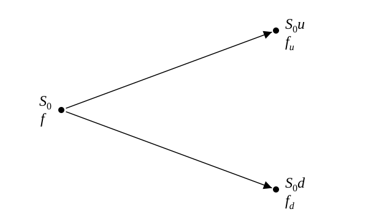

*The following was written by me, but reviewed by Claude for grammar and math mistakes.*

Binomial trees are still foundational to option pricing (even with Black-Scholes being known).  They are extremely simple to understand and, with optimized programs, extremely fast to compute.  For this post, we will just go over the basics (and this will serve kind of as my notes from Hull).

## Building a riskless portfolio

Here, as is usual in coming up with prices, we first try to create a simple riskless portfolio -- that is, a portfolio whose price is stable regardless of certain price moves.  For this, let's just make a portfolio that contains some amount of stock ($\Delta$ shares) whose price is $S_0$ and a short position in a single option on the stock (or any other derivative that is a function of the underlying) whose price is $f$.  Let's have the following:

- the option lasts for a time $T$
- during that time, the underlying can either move up to $S_0 u$ or down to $S_0 d$, where $u > 1$ and $0 < d < 1$
- if the stock moves up then the option pays off $f_u$, and if it moves down it pays off $f_d$

For a more intuitive picture:

*Figure adapted from Options, Futures, and Other Derivatives.*[^hull]

(Why two paths and not three?  Will save trinomial trees for another dedicated post.)

Now, our simple portfolio has the following value at the end:

$$S_0 u \Delta - f_u \quad \text{if the underlying goes up}$$

$$S_0 d \Delta - f_d \quad \text{if the underlying goes down}$$

To make this riskless, we need to ensure that the value of going up or down is the same, that is:

$$S_0 u \Delta - f_u = S_0 d \Delta - f_d$$

or

$$\Delta = \frac{f_u - f_d}{S_0 u - S_0 d}$$

## Pricing it with no arbitrage

Now, we can make our single and only assumption:

- two riskless portfolios (that is, two portfolios with a guaranteed final value) that cost the same amount to set up must end with the same final value (this is the no-arbitrage assumption).

After all, if it were possible to violate this, then you could guarantee free, riskless money.  Such opportunities do exist in high-frequency trading (HFT), but they are incredibly difficult to capture and can be assumed not to exist for the purpose of this calculation.

So, creating this portfolio requires this much cash up front:

$$S_0 \Delta - f$$

With that much cash, instead of creating this underlying-and-option portfolio, I could just invest it at the risk-free rate $r$ and guarantee a final value of $(S_0 \Delta - f) e^{rT}$.  But we already know this should equal $S_0 u \Delta - f_u$, because both portfolios are riskless and cost the same amount to set up:

$$(S_0 \Delta - f) e^{rT} = S_0 u \Delta - f_u$$

or

$$S_0 \Delta - f = (S_0 u \Delta - f_u) e^{-rT}$$

or

$$f = S_0 \Delta (1 - u e^{-rT}) + f_u e^{-rT}$$

Substituting our expression for $\Delta$:

$$f = S_0 \left( \frac{f_u - f_d}{S_0 u - S_0 d} \right) (1 - u e^{-rT}) + f_u e^{-rT}$$

or

$$f = \frac{f_u (1 - d e^{-rT}) + f_d (u e^{-rT} - 1)}{u - d}$$

or

$$f = e^{-rT} \left[ p f_u + (1 - p) f_d \right]$$

where

$$p = \frac{e^{rT} - d}{u - d}$$

## Risk-neutral valuation

Now, to illustrate an incredible property of pricing algorithms, let's see how this binomial option would be priced in a risk-neutral world.  Risk-neutral valuation says that, when valuing a derivative, we can make the assumption that investors are risk-neutral and do not expect increased returns when they take on increased risk.  This is a weird concept because that is clearly not the world we live in (and yet it will prove to be incredibly valuable).

The two most important features of this risk-neutral world are:

1.  The expected return on a stock is just the risk-free rate:  $E(S_T) = S_0 e^{\mu T} = S_0 e^{rT}$, where $\mu$ is the expected return on the stock and $r$ is the risk-free rate.
2.  The discount rate used for the expected payoff of an option is the risk-free rate:  a payoff of \\$10 in two months is worth $\\$10 \, e^{-r \cdot 2/12}$ today (with $r = 12\%$ per year, that is $\\$10 \, e^{-0.02} \approx \\$9.80$).  The risk it took to get that payoff does not matter.

With those properties, let's continue to our derivation.  Let's define $q$ as the probability of an up movement in this risk-neutral world.  Then, the expected payoff of our option is just $q f_u + (1 - q) f_d$.  Using property 2, we can get the present value to be $e^{-rT} \left[ q f_u + (1 - q) f_d \right]$.  Now, let's derive $q$.  We know the expected stock price should grow at the risk-free rate, so, invoking property 1:

$$E(S_T) = S_0 e^{rT} = q S_0 u + (1 - q) S_0 d$$

We can now solve for $q$ to obtain

$$q = \frac{e^{rT} - d}{u - d}$$

In summary, we have the value of the option to be

$$f = e^{-rT} \left[ q f_u + (1 - q) f_d \right] \quad \text{with} \quad q = \frac{e^{rT} - d}{u - d}$$

This is exactly the result we saw in our world, with $q$ equal to the $p$ we found before!  We made some super strong assumptions and yet came to the same equation!

## Real world vs. risk-neutral world

It is critical to note that $p$, the probability of an up movement in a risk-neutral world, does *NOT* equal the probability of an up movement in our world.  In general, the risk-neutral probability is $p = (e^{rT} - d) / (u - d)$, while the real-world probability is $p^* = (e^{\mu T} - d) / (u - d)$ (from the same argument as before, with the stock's real-world expected return $\mu$ in place of $r$), where $\mu \neq r$ (and $\mu$ is probably larger, as stocks are risky).  Even then, we can't easily find the discount rate to use.  We can't use $e^{-\mu T}$ here, as that would imply that the option's risk is equal to the stock's risk, which is wrong, as options are far riskier.  Here, in this simple example, we *can* find the discount rate because we already calculated the option price, $f$.  Calling the unknown discount rate $k$, we just need to solve

$$f = e^{-kT} \left[ p^* f_u + (1 - p^*) f_d \right]$$

so that

$$k = \frac{1}{T} \ln \frac{p^* f_u + (1 - p^*) f_d}{f}$$

All this complication is removed in a risk-neutral world, as the discount rate is just the risk-free rate!

## Writing u and d in terms of volatility

With all of that stated, let's go back to the weird "u" and "d" terms -- the terms that represented the multiplier for an up jump or a down jump.  Let's try to write $u$ and $d$ as functions of the same underlying variable:  volatility.  As previously discussed in [my post on Wiener processes](/math/2026/08/09/sqrt-delta-t-in-wiener-processes.html), the standard deviation of the stock's return in a short period of time $\Delta t$ is $\sigma \sqrt{\Delta t}$ -- here, return just means (how much we net made) / (how much we invested).  Since variance is the standard deviation squared, we have a variance of $\sigma^2 \Delta t$.  Also, recall the [definition of variance](/math/2026/08/09/sqrt-delta-t-in-wiener-processes.html#definition-of-variance),

$$\text{Var}(X) = E\left[(X - E[X])^2\right] = E[X^2] - E[X]^2$$

On an upswing, the stock price moves from $S_0$ to $S_0 u$, so the return here is $(S_0 u - S_0) / S_0 = u - 1$.  Similarly, for the downswing, we have $d - 1$.  Call this one-step return $X$.  Then, with $p$ from before (for our one-step tree, $\Delta t = T$), the expected return is

$$E[X] = p(u - 1) + (1 - p)(d - 1)$$

and matching the variance of the return to $\sigma^2 \Delta t$ gives

$$\text{Var}(X) = p(u - 1)^2 + (1 - p)(d - 1)^2 - \left[ p(u - 1) + (1 - p)(d - 1) \right]^2 = \sigma^2 \Delta t$$

Substituting

$$p = \frac{e^{r \Delta t} - d}{u - d}$$

is easier if we first note that it is just $p u + (1 - p) d = e^{r \Delta t}$ rearranged, so

$$E[X] = e^{r \Delta t} - 1$$

and

$$E[X^2] = p u^2 + (1 - p) d^2 - 2 \left[ p u + (1 - p) d \right] + 1 = p u^2 + (1 - p) d^2 - 2 e^{r \Delta t} + 1$$

so that

$$\text{Var}(X) = E[X^2] - E[X]^2 = p u^2 + (1 - p) d^2 - e^{2 r \Delta t}$$

Now substituting $p$ into the first two terms,

$$p u^2 + (1 - p) d^2 = d^2 + p (u^2 - d^2) = d^2 + (e^{r \Delta t} - d)(u + d) = e^{r \Delta t} (u + d) - u d$$

and we get

$$e^{r \Delta t} (u + d) - u d - e^{2 r \Delta t} = \sigma^2 \Delta t$$

This is one equation in two unknowns, $u$ and $d$, so it has many solutions and we need one more condition to pin one down.  Cox, Ross, and Rubinstein[^crr] chose $d = 1/u$, which makes the tree symmetric about $S_0$ (an up move followed by a down move returns to the starting price); other choices exist, and all of them agree as $\Delta t \to 0$.  Writing $u = e^{x}$ and $d = e^{-x}$, we have $u d = 1$ and, expanding the exponentials,

$$u + d = e^{x} + e^{-x} = 2 + x^2 + \frac{x^4}{12} + \cdots$$

$$e^{r \Delta t} = 1 + r \Delta t + \cdots \qquad e^{2 r \Delta t} = 1 + 2 r \Delta t + \cdots$$

Substituting these in and keeping only terms up to first order in $\Delta t$ (with $x^2$ itself of order $\Delta t$),

$$(1 + r \Delta t)(2 + x^2) - 1 - (1 + 2 r \Delta t) = x^2 + (\text{terms in } \Delta t^2 \text{ and higher})$$

so the equation reduces to $x^2 = \sigma^2 \Delta t$, that is

$$u = e^{\sigma \sqrt{\Delta t}} \qquad \text{and} \qquad d = e^{-\sigma \sqrt{\Delta t}}$$

Notably, if we instead substituted our world's probability of an up movement, $p^* = (e^{\mu \Delta t} - d) / (u - d)$, we'd get the same equation with $\mu$ in place of $r$,

$$e^{\mu \Delta t} (u + d) - u d - e^{2 \mu \Delta t} = \sigma^2 \Delta t$$

and, to first order in $\Delta t$, the same $u$ and $d$!  That is, regardless of whether we are in a risk-neutral world or the real world, the *size* of the jumps is the same; only the probability of each jump differs.  This is a much deeper point about Girsanov's theorem that we will explore in the [appendix](#appendix-girsanovs-theorem).

## Putting it all together

Now, our full equation for $f$ is:

$$f = e^{-rT} \left[ p f_u + (1 - p) f_d \right]$$

where, substituting our derived $u = e^{\sigma \sqrt{T}}$ and $d = e^{-\sigma \sqrt{T}}$ (with $\Delta t = T$ for our one-step tree) and, since we are focusing on a call option with strike $K$, the payoffs at the two nodes are

$$f_u = \max(S_0 u - K,\ 0) = \max\left(S_0 e^{\sigma \sqrt{T}} - K,\ 0\right)$$

$$f_d = \max(S_0 d - K,\ 0) = \max\left(S_0 e^{-\sigma \sqrt{T}} - K,\ 0\right)$$

and

$$p = \frac{e^{rT} - d}{u - d} = \frac{e^{rT} - e^{-\sigma \sqrt{T}}}{e^{\sigma \sqrt{T}} - e^{-\sigma \sqrt{T}}}$$

Notice how the equation for the option price, $f$, does *not* depend on the probability of the underlying swinging up or down.  Instead, it depends purely on the volatility (and the observable $S_0$, $K$, $r$, and $T$).  This is where the "vol-centric" trading approach comes from:  it does not matter where the underlying is going to go, it just matters how large those jumps could be.  That is "all" that is important, and we already see this in this simple binomial model!  While this may seem counterintuitive, the standard argument is that the underlying stock price itself already incorporates the probabilities of these future movements (and therefore, we would be double counting if we incorporated them into our option price).

For a final point on the power of binomial trees, if you increase the number of steps to infinity you can recover the original Black-Scholes formula.  That proof has a fairly easy setup and an extremely difficult execution but is worth looking at.  This post is already long enough so I'll save that for another blog post.

## Appendix: Girsanov's theorem

When we move from the risk-neutral world to the real world, the expected return from the stock price changes, but its volatility remains the same.[^hull-measures]

## Appendix: Sources

[^hull]: John C. Hull, *Options, Futures, and Other Derivatives*, Global Edition, 11th ed., Pearson, Chapter 13, "Binomial Trees".

[^hull-measures]: John C. Hull, *Options, Futures, and Other Derivatives*, Global Edition, 11th ed., Pearson, Chapter 28, "Martingales and Measures".

[^crr]: John C. Cox, Stephen A. Ross, and Mark Rubinstein, ["Option Pricing: A Simplified Approach"](https://www.sciencedirect.com/science/article/pii/0304405X79900151), Journal of Financial Economics, Vol. 7, No. 3, 1979, pp. 229-263.
